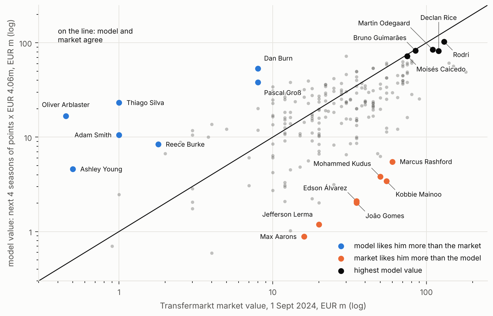
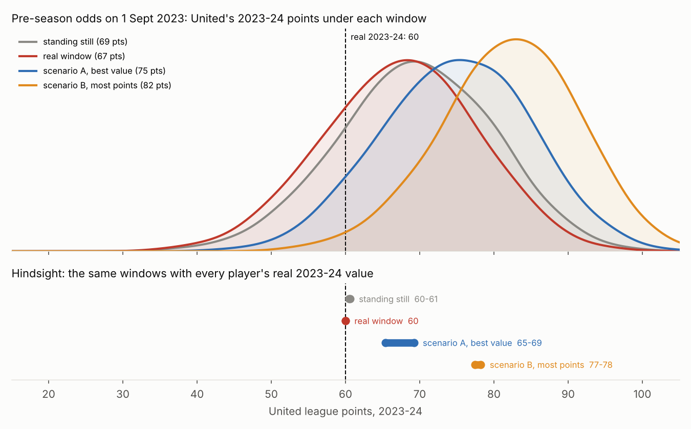

# Football analytics: what is a Premier League player worth?

How many league points does a player add, what is that worth in money, and how does it compare with what the
market pays for him in fees and wages?

**[Read the report (PDF, 12 pages)](report/football_analytics_report.pdf)**

**[Case study: What should United have done in summer 2023? (PDF, 8 pages)](report/united_case_summer_2023.pdf)**,
two transfer windows from the model against the real one, decided on 2022-23 data and graded on 2023-24

Every player in the big five leagues is priced in league points and money. Player impact comes from RAPM on
non-penalty xG with a box-score prior, projected forward with aging curves by position, keeper shot-stopping,
league strength from European games and an injury model built from matchday squads. It is turned into points above
replacement by calibrating on team results and priced at what a point earns in Premier League prize money, about
EUR 4.1m. A wage model fitted on 59 press-reported wages and checked against 126 sets of club accounts puts the cost
side in. Free data only, seasons 2014-15 to 2023-24. A follow-up to [nba-moneyball](https://github.com/Viktorsadowski/nba-moneyball).



Main findings:

- The market pays a third more for strikers than their points are worth and a fifth less for defenders. It pays
  for youth: 18-21-year-olds go for 39% over the model, players over 33 for about half.
- When the model and the market disagree, the market moves towards the model the next year, in all ten seasons.
- Big fees buy points at a higher price (about EUR 35m per point delivered for EUR 60m+ signings, EUR 10m under
  EUR 5m), but the model picks the better deals inside every fee band.
- Adding wages, contract length and resale to a signing's value ranks real Premier League signings better (rank
  correlation 0.44 against 0.32 without).
- Defensive event stats (tackles, interceptions, clearances) add almost nothing to what xG data already says.
- Manchester United, summer 2023, same net spend on fees (EUR 142m) and squad rules: the model's most-points
  scenario (Bruno Guimarães, Theo Hernández, Udogie, Botman, Solly March, Sørloth) comes to about 77-78 league
  points with the players' real 2023-24 values, against the 60 United got.



## Data

| Source | What | Terms |
|---|---|---|
| Understat, via third-party dumps | shots with xG, rosters, minutes, positions, subs, 2014-15 to 2023-24 | understat.com disallows crawling, so nothing was scraped |
| [transfermarkt-datasets](https://github.com/dcaribou/transfermarkt-datasets) | lineups, squads, market values, transfers, contracts | no licence stated |
| [StatsBomb open data](https://github.com/statsbomb/open-data) | event data 2015-16 (pulled by statsbomb_pull.py) | free, credit StatsBomb |
| Wyscout public dataset, Pappalardo et al. 2019 (figshare) | event data 2017-18 | CC BY 4.0 |
| [football-data.co.uk](https://www.football-data.co.uk) | results and Pinnacle odds | free |
| Club accounts and press reports | wage bills, player wages, contract ends | one source link per row in manual/ |

FBref and Capology are left out on their terms of use, including copies of their data on Kaggle. data/ is
gitignored: only code and derived results are in the repository.

## Run order

```
pip install -r requirements.txt
python src/run_all.py                    # everything below in order, ~15 min, one log per step in logs/
python src/run_all.py --from war         # from a step on
```

or step by step:

```
python src/ingest.py              # understat dumps -> matches, lineups, shots
python src/segments.py            # every match split at subs and red cards
python src/rapm.py                # O/D RAPM on npxG per 90, pooled 4-season window
python src/box_prior.py           # RAPM again, shrunk towards a box-score prior per position (plain kept in rapm_plain)
python src/tm_match.py            # understat <-> transfermarkt ids, birth dates, market values
python src/gk.py                  # keeper shot-stopping, empirical Bayes
python src/aging.py               # aging curves by position, ghost seasons -> figures/aging_curve.png
python src/elo.py                 # our own Elo on 1 August (ClubElo wasn't reachable)
python src/inferred_injuries.py   # injuries from matchday squads + recall / precision checks (manual/)
python src/injury.py              # injury risk next season
python src/availability.py        # share of team minutes next season
python src/war.py                 # calibrated value, shrink, points above replacement
python src/league_strength.py     # league offsets from European games (needs war.parquet)
python src/war.py                 # again, now with league strength in
python src/price.py               # euros per point from prize money -> figures/eur_per_point.png
python src/market_value.py        # model value vs market value + the market-moves-towards-the-model test
python src/statsbomb_pull.py      # statsbomb 2015-16 events (download, once)
python src/event_stats.py         # defensive and passing stats from statsbomb + wyscout
python src/defense_study.py       # do they add to the prior?
python src/side_questions.py      # positions, age, big fees, overreaction -> figures/side_*.png
python src/forecast_backtest.py   # August forecasts vs last season, Elo and the odds
python src/wages.py               # wage model (reported wages + club accounts), contract length
python src/transfer_value.py      # what a signing is worth to a PL buyer + backtest
python src/united_case.py         # the summer 2023 case: scenarios A, B, real window, hindsight on 2023-24
python src/season_sim.py          # 2023-24 simulated 20,000 times per window -> figures/season_sim.png

python report/make_figures.py && python report/build_report.py
python report/make_case_figures.py && python report/build_case.py
```

Set FOOTBALL_DATA_DIR to keep the data folder outside the repository (e.g. outside OneDrive).
